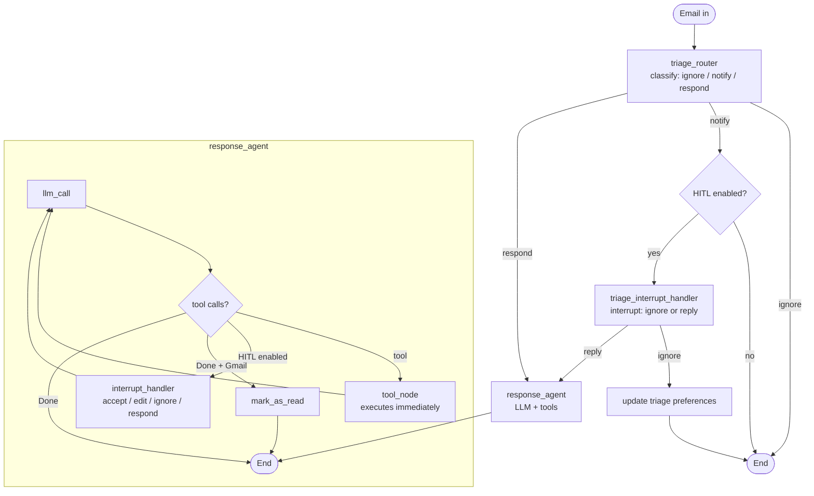

# Mailroom

**A human-in-the-loop email triage and reply agent built with LangGraph.**

Mailroom reads an incoming email, decides whether it needs a reply, and — when it
does — drafts or sends one on your behalf. Every outbound action can be routed
through a human for review, and the feedback from those reviews is stored so the
assistant gets better at triaging and writing in your voice over time.

It is a small, readable reference implementation rather than a framework: one
configurable graph, a handful of tools, and presets that show how the pieces fit
together.

---

## Table of contents

- [Why Mailroom](#why-mailroom)
- [How it works](#how-it-works)
- [Graph presets](#graph-presets)
- [Project structure](#project-structure)
- [Requirements](#requirements)
- [Setup](#setup)
- [Configuration](#configuration)
- [Usage](#usage)
- [Gmail and Google Calendar](#gmail-and-google-calendar)
- [Scheduled ingestion](#scheduled-ingestion)
- [Evaluation and tests](#evaluation-and-tests)
- [Extending Mailroom](#extending-mailroom)
- [Design notes and limitations](#design-notes-and-limitations)
- [Attribution](#attribution)

---

## Why Mailroom

Most "email agent" demos are a single prompt in a loop. Mailroom separates the
two jobs that actually need different behaviour:

1. **Triage** — should this email be ignored, surfaced to you, or answered?
   This is a classification problem, so it gets a structured-output model call
   with explicit rules.
2. **Response** — actually handle the email: check availability, schedule a
   meeting, write a reply. This is a tool-using agent loop.

On top of that, Mailroom adds three production-shaped concerns that are usually
left as an exercise:

- **Human-in-the-loop (HITL).** Outbound actions (`send_email`, `schedule_meeting`,
  `Question`) pause the graph before they run. A human can accept, edit, ignore,
  or reply with feedback. The graph is compatible with
  [Agent Inbox](https://github.com/langchain-ai/agent-inbox).
- **Memory.** Edits and feedback are distilled into long-term preference
  profiles (triage rules, response style, calendar preferences) stored in a
  LangGraph Store, then injected into future prompts.
- **A single source of truth for the workflow.** The four original variants of
  the assistant (basic, HITL, HITL + memory, Gmail) are now one builder with
  feature flags, so a fix lands everywhere at once.

## How it works



A run looks like this:

1. `triage_router` loads the triage preference profile (if memory is enabled),
   calls a model with structured output, and routes on the result.
2. `respond` → `response_agent` runs a tool loop until the model calls `Done`.
3. `notify` → ends immediately, or interrupts so you can decide to reply anyway.
4. When HITL is enabled, each outbound tool call is an `interrupt()` carrying a
   description and an action request. Resuming with `Command(resume=...)`
   accepts, edits, ignores, or supplies feedback.
5. With memory enabled, feedback is summarised into the relevant preference
   profile in the store and used by the next run.

## Graph presets

All presets are built by `mailroom.graph.build_workflow(GraphOptions(...))` and
exposed through `langgraph.json`.

| Graph ID          | Preset   | HITL | Memory | Gmail tools | Use it for |
| ----------------- | -------- | :--: | :----: | :---------: | ---------- |
| `mailroom`        | `basic`  |  —   |   —    |      —      | The core loop; simplest to read and test |
| `mailroom_hitl`   | `hitl`   |  ✓   |   —    |      —      | Reviewing drafts before they are sent |
| `mailroom_memory` | `memory` |  ✓   |   ✓    |      —      | Learning preferences from feedback |
| `mailroom_gmail`  | `gmail`  |  ✓   |   ✓    |      ✓      | Real inbox: Gmail + Google Calendar |
| `mailroom_cron`   | —        |  —   |   —    |      ✓      | Scheduled Gmail ingestion on LangGraph Platform |

## Project structure

```
.
├── langgraph.json              # Graph ID → module bindings for `langgraph dev`
├── pyproject.toml              # Package metadata, dependencies, ruff/pytest config
├── .env.example                # Copy to .env
├── src/mailroom/
│   ├── graph.py                # GraphOptions + build_workflow + the five presets
│   ├── config.py               # Environment-driven Settings
│   ├── schemas.py              # Graph state, RouterSchema, UserPreferences
│   ├── llm.py                  # Chat-model factories
│   ├── memory.py               # Store-backed preference profiles
│   ├── prompts/                # Triage, response, tool, and memory prompts
│   │   ├── triage.py
│   │   ├── response.py
│   │   ├── tools.py
│   │   ├── memory.py
│   │   └── defaults.py
│   ├── tools/
│   │   ├── mock.py             # Deterministic email/calendar tools
│   │   ├── registry.py         # Tool lookup, including lazy Gmail tools
│   │   └── gmail/              # Real Gmail/Calendar tools, OAuth, ingestion, cron
│   ├── utils.py                # Parsing, formatting, notebook helpers
│   ├── cron.py                 # Ingestion graph for scheduled jobs
│   └── eval/                   # Triage dataset, grader prompts, evaluation script
├── tests/                      # Pytest suite + LangSmith runner
└── notebooks/                  # Walkthroughs: agent, evaluation, HITL, memory
```

`src/mailroom` never calls `load_dotenv()` at import time. Credentials are read
lazily via `mailroom.config.get_settings()`, so importing a graph offline is
always safe.

## Requirements

- **Python 3.11–3.13** (`pyproject.toml` enforces this; LangGraph requires 3.11+)
- A model provider key. The default is Google Gemini:
  [`GOOGLE_API_KEY`](https://aistudio.google.com/apikey)
- Optional: a `LANGSMITH_API_KEY` for tracing and evaluation
- Optional: a Google Cloud project with the Gmail and Calendar APIs enabled for
  the `mailroom_gmail` preset

## Setup

```bash
git clone https://github.com/hammadallauddin/mailroom.git
cd mailroom            # or whatever you named the directory

python -m venv .venv
# Windows
.venv\Scripts\activate
# macOS / Linux
source .venv/bin/activate

pip install -e ".[dev]"   # dev extras add pytest, ruff, mypy, notebooks
```

Create your environment file:

```bash
cp .env.example .env
```

Then fill in at least:

```dotenv
GOOGLE_API_KEY=...
```

## Configuration

Settings are read from the environment (and `.env`) when first needed.

| Variable               | Default                             | Purpose |
| ---------------------- | ----------------------------------- | ------- |
| `GOOGLE_API_KEY`       | —                                   | Credentials for the default Gemini model |
| `MAILROOM_MODEL`       | `google_genai:gemini-2.5-flash`      | Any `provider:model` id supported by `init_chat_model` |
| `MAILROOM_EVAL_MODEL`  | `openai:gpt-4o`                     | Model used by the LLM judge in the test suite |
| `MAILROOM_TEMPERATURE` | `0`                                 | Temperature for the response agent |
| `MAILROOM_BACKGROUND`  | A short software-engineer persona    | Who the assistant works for; injected into prompts |
| `MAILROOM_NAMESPACE`   | `mailroom`                          | Root namespace for stored preference profiles |
| `LANGSMITH_TRACING`    | —                                   | Set to `true` to trace runs |
| `LANGSMITH_API_KEY`    | —                                   | LangSmith credentials |
| `LANGSMITH_PROJECT`    | —                                   | Trace/evaluation project name |
| `EMAIL_ADDRESS`        | —                                   | Default mailbox for Gmail ingestion |

To change provider, set `MAILROOM_MODEL` and install the matching LangChain
integration. For example:

```dotenv
MAILROOM_MODEL=openai:gpt-4o-mini
```

```bash
pip install langchain-openai
```

Preference profiles themselves live in the LangGraph Store under
`(<MAILROOM_NAMESPACE>, <profile>)` where `<profile>` is `triage_preferences`,
`response_preferences`, or `cal_preferences`.

## Usage

### Try it in Python

```python
from langgraph.checkpoint.memory import MemorySaver
from mailroom.graph import GraphOptions, build_workflow

assistant = build_workflow(GraphOptions()).compile(checkpointer=MemorySaver())

email = {
    "author": "Alice Smith <alice@example.com>",
    "to": "you@example.com",
    "subject": "Quick question about the API docs",
    "email_thread": "Are /auth/refresh and /auth/validate intentionally undocumented?",
}

result = assistant.invoke(
    {"email_input": email},
    config={"configurable": {"thread_id": "demo-1"}},
)

print(result["classification_decision"])  # "respond"
for message in result["messages"]:
    print(message.pretty_repr())
```

Swap in a different preset by changing the options:

```python
assistant = build_workflow(GraphOptions(hitl=True, memory=True)).compile(
    checkpointer=MemorySaver(),
    store=InMemoryStore(),   # required for memory to persist
)
```

### Resuming a HITL interrupt

When HITL is on, the first `invoke` returns with an `__interrupt__` key. Inspect
the action request, then resume:

```python
from langgraph.types import Command

state = assistant.invoke({"email_input": email}, config=config)
request = state["__interrupt__"][0].value[0]
print(request["action_request"])   # {"action": "write_email", "args": {...}}

# Accept the draft as-is
result = assistant.invoke(Command(resume=[{"type": "accept"}]), config=config)

# …or edit it: {"type": "edit", "args": {"action": ..., "args": {...}}}
# …or ignore it: {"type": "ignore"}
# …or reply with feedback: {"type": "respond", "args": "make it shorter"}
```

Edits and feedback also update the relevant preference profile when memory is
enabled.

### Run the LangGraph dev server

```bash
langgraph dev
```

This reads `langgraph.json` and serves every preset at
`http://127.0.0.1:2024`. Point [Agent Inbox](https://dev.agentinbox.ai/) at that
URL and use graph ID `mailroom_hitl`, `mailroom_memory`, or `mailroom_gmail` to
review interrupted threads in a UI.

### Walk through the notebooks

The notebooks are a guided tour of how the pieces were built:

| Notebook                  | Topic |
| ------------------------- | ----- |
| `notebooks/agent.ipynb`        | Triage + response loop from first principles |
| `notebooks/evaluation.ipynb`   | Dataset-driven evaluation with LangSmith |
| `notebooks/hitl.ipynb`         | Adding interrupts and Agent Inbox |
| `notebooks/memory.ipynb`       | Learning preferences from feedback |
| `notebooks/langgraph_101.ipynb`| Minimal LangGraph warm-up |

```bash
pip install -e ".[dev]"
jupyter lab notebooks/
```

The notebooks import `mailroom.*`, so the editable install (or
`PYTHONPATH=src`) is required.

## Gmail and Google Calendar

The `mailroom_gmail` graph replaces the mock tools with real ones:
`send_email_tool`, `check_calendar_tool`, `schedule_meeting_tool`, plus message
fetching and `mark_as_read`.

Setup at a glance (full walkthrough in
[`src/mailroom/tools/gmail/README.md`](src/mailroom/tools/gmail/README.md)):

1. Enable the Gmail and Google Calendar APIs in a Google Cloud project.
2. Create OAuth credentials for a **Desktop app** and download the JSON.
3. Save it as `src/mailroom/tools/gmail/.secrets/secrets.json`.
4. Run the auth flow once to produce `token.json`:

   ```bash
   python src/mailroom/tools/gmail/setup_gmail.py
   ```

5. Start the server (`langgraph dev`) and submit real emails to it:

   ```bash
   python src/mailroom/tools/gmail/run_ingest.py \
     --email you@example.com \
     --minutes-since 120 \
     --graph-name mailroom_gmail
   ```

Useful ingestion flags: `--include-read`, `--skip-filters`, `--rerun`,
`--early`, `--mock`, `--url`.

> **Security note.** `.secrets/` contains OAuth tokens that can read and send
> mail. Keep it out of version control and never commit `.env`.

## Scheduled ingestion

`src/mailroom/cron.py` wraps the same ingestion function in a tiny graph
(`mailroom_cron`) so LangGraph Platform can run it on a schedule. Create the
cron job against a hosted deployment with:

```bash
python src/mailroom/tools/gmail/setup_cron.py \
  --email you@example.com \
  --url https://your-deployment.us.langgraph.app \
  --schedule "*/10 * * * *" \
  --graph-name mailroom_gmail
```

For hosted deployments, set `GMAIL_SECRET` and `GMAIL_TOKEN` to the full
contents of `secrets.json` and `token.json` instead of shipping the files.

## Evaluation and tests

There are two layers:

**1. Offline checks** — no API keys needed:

```bash
python -m compileall -q src tests
pytest --collect-only -q          # validates imports, fixtures, and params
```

**2. Live evaluations** — call real models and log to LangSmith. These need
`GOOGLE_API_KEY`, `OPENAI_API_KEY` (the grader), and `LANGSMITH_API_KEY`.

```bash
# Tool-use + response-quality tests against the basic preset
pytest tests/test_response.py -v --agent-module basic

# Wrapper that sets LangSmith project/experiment env vars for you
python tests/run_all_tests.py --implementation basic

# Triage accuracy against the LangSmith dataset "Mailroom: E-mail Triage Dataset"
python -m mailroom.eval.evaluate_triage
```

The evaluation script creates the dataset on first run, computes a
classification score, and writes a chart to `src/mailroom/eval/results/`.

The test suite currently automates the `basic` preset. HITL/memory behaviour is
best exercised interactively through Agent Inbox or the smoke pattern shown in
[Usage](#usage).

## Extending Mailroom

**Change the persona or rules.** Edit `MAILROOM_BACKGROUND`, or the default
profiles in `src/mailroom/prompts/defaults.py`. With memory enabled, the stored
profile wins over the defaults.

**Add a tool.** Define it in `src/mailroom/tools/mock.py` (or a new module), then
register its name in `src/mailroom/tools/registry.py`. If it is an outbound
action that should pause for review, add it to `GraphOptions.hitl_tools` and to
`HITL_ACTIONS` in `graph.py`; if its feedback should train a preference
profile, add it to `PREFERENCE_BY_TOOL`.

**Add a preset.** Build one more `GraphOptions` combination and add a line to
`langgraph.json`:

```python
# src/mailroom/graph.py
review_only = build_workflow(GraphOptions(hitl=True)).compile()
```

```json
"mailroom_review": "./src/mailroom/graph.py:review_only"
```

**Swap models.** Prefer `mailroom.llm.get_chat_model()` over direct
`init_chat_model` calls so temperature and provider stay consistent.

## Design notes and limitations

- **Mock tools are mocks.** `write_email`, `schedule_meeting`, and
  `check_calendar_availability` return descriptive strings. They exist so the
  graph is runnable and testable without credentials. Only the Gmail preset
  performs real side effects.
- **Triage is a single model call.** There is no retrieval over past emails; the
  memory feature stores preference text, not an email index.
- **Memory is LLM-rewritten.** Preference profiles are updated by asking a model
  to rewrite the profile. It preserves the existing text by instruction, not by
  construction, so long-running profiles should be reviewed occasionally.
- **Interrupt payloads are Agent Inbox-shaped.** If you build a custom review UI,
  read `action_request`, `config`, and `description` from the interrupt value.
- **Ingestion assumes a reachable LangGraph server.** `run_ingest.py` uses the
  LangGraph SDK, so it must point at a local (`langgraph dev`) or hosted
  deployment.
- **No retry/rate-limit policy** is built into the graph; add LangGraph retry
  policies around model and tool nodes if you run this at volume.

## Attribution

Mailroom began as a refactor of the
[`langchain-ai/agents-from-scratch`](https://github.com/langchain-ai/agents-from-scratch)
tutorial ("ambient" email agent). The tutorial's progression — basic agent,
evaluation, HITL, memory, Gmail — is preserved as presets and notebooks, while
the code has been consolidated, renamed, and documented here.
